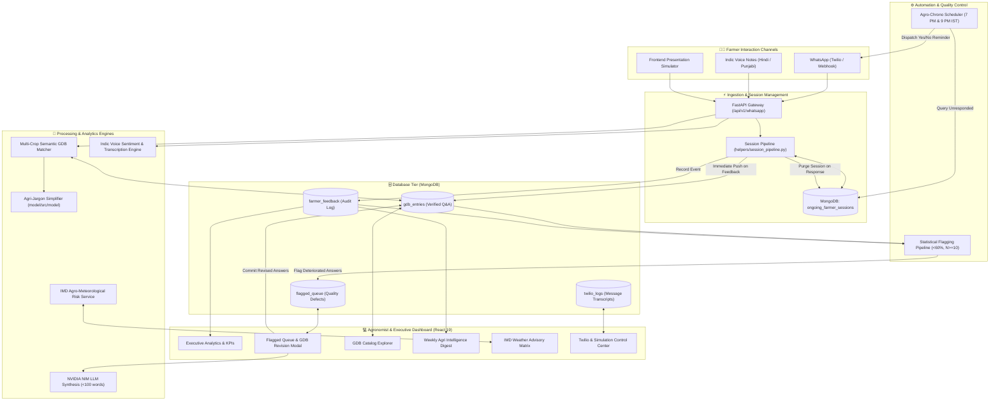
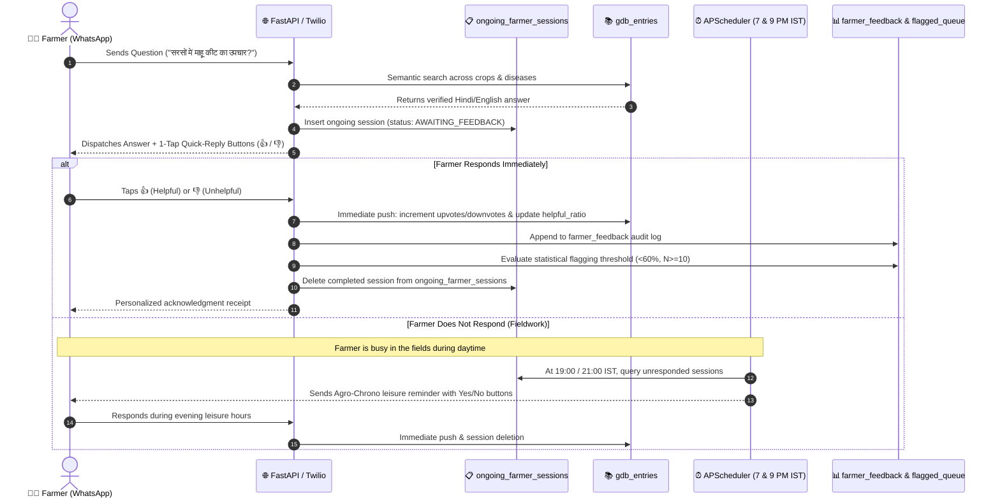
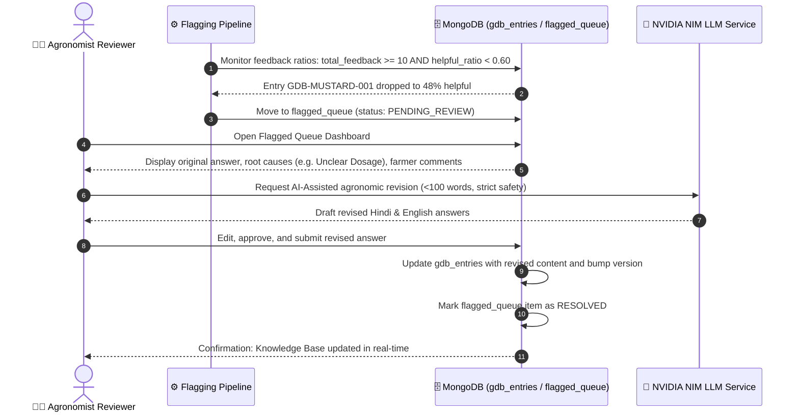

# 🌾 AjraSakha Agri-Intel | System Architecture & Technical Specifications

> **Farmer Answer Feedback Loop & Autonomous Quality Assurance System**  
> *Developed for AjraSakha (ANNAM.AI / IIT Ropar) — Data Science & Full-Stack Track*

---

## 📌 Executive Summary

**AjraSakha Agri-Intel** is an end-to-end, full-stack agricultural intelligence and autonomous quality feedback pipeline designed for Indian smallholder farmers interacting with the **AjraSakha** AI advisory bot.

While AI-driven agricultural advisory bots can dispense valuable farming guidance across millions of queries, real-world deployment faces severe field challenges:
1. **The Fieldwork-Feedback Void**: Farmers working during daytime hours cannot fill out lengthy web forms or respond while working in fields.
2. **Cognitive & Literacy Barriers**: Technical jargon (e.g., milliliters per hectare, chemical concentrations) alienates farmers who measure inputs in 15-liter spray tanks (*"टंकी"*).
3. **Silent Answer Drift & Hallucination**: Without continuous quality feedback, inaccurate or localized mismatches go unnoticed until crop damage occurs.
4. **Lack of Agronomist Oversight**: Agricultural scientists (KVK/ICAR) lack unified interfaces to review, revise, and update faulty knowledge base answers.

**AjraSakha Agri-Intel** resolves these challenges by introducing:
- **1-Tap Quick-Reply WhatsApp Feedback** and **Indic Voice Note Sentiment Analysis**.
- **Agro-Chrono Evening Leisure Nudges** scheduled at **7:00 PM** and **9:00 PM IST** exclusively for unresponded farmers.
- **Immediate GDB Metric Synchronization** with zero-delay rating updates and session cleanup.
- **Statistical Flagging Pipeline** (Wilson score / `< 60%` helpful ratio with `N >= 10` responses).
- **Agronomist Quality Resolution UI** powered by **NVIDIA NIM LLM synthesis** constrained to `< 100` words in Hindi and English.
- **Agri-Jargon Simplifier NLP Engine** mapping technical dosages into village-level vernacular.
- **Live IMD Agro-Meteorological Weather Matrix** correlating weather risks with dynamic crop advisories.

---

## 🏛️ System Architecture



---

## 🔄 Core Workflows & Lifecycles

### 1. Farmer Inquiry & 1-Tap Feedback Lifecycle



### 2. Statistical Flagging & Agronomist Revision Loop



---

## 📂 Repository Structure

```
FarmersFeedback/
├── backend/                        # FastAPI Application Server
│   ├── app/
│   │   ├── main.py                 # Application factory, lifespan, middleware, routers
│   │   ├── config.py               # Pydantic v2 application settings & environment variables
│   │   ├── database.py             # MongoDB client initialization, indexing, connection pooling
│   │   ├── scheduler.py            # APScheduler background daemon initialization
│   │   └── routers/
│   │       ├── analytics.py        # Executive KPI counts, root cause breakdown, state metrics
│   │       ├── digest.py           # Weekly intelligence bulletin generator & export
│   │       ├── flagged.py          # Quality queue endpoints, threshold config, resolution
│   │       ├── gdb.py              # Knowledge base search, filtering, and CRUD operations
│   │       ├── weather.py          # IMD weather alerts & agro-meteorological advisory
│   │       └── whatsapp.py         # Inbound/outbound webhook, question answering, session lifecycle
│   ├── main.py                     # Backend entry point alias
│   ├── seed_data.py                # Database seeder (300+ synthetic feedbacks, GDB catalog)
│   └── test_suite.py               # Automated portable test runner for all endpoints
│
├── frontend/                       # React 19 + TypeScript + Vite Dashboard
│   ├── src/
│   │   ├── components/             # Reusable UI Components
│   │   │   ├── AnalyticsView.tsx       # KPI metrics, domain charts, regional satisfaction
│   │   │   ├── BackendOfflineError.tsx # Graceful backend connection health warning
│   │   │   ├── FlaggedQueueView.tsx    # Agronomist resolution modal & threshold editor
│   │   │   ├── GdbCatalogView.tsx      # Multi-crop searchable knowledge base
│   │   │   ├── Header.tsx              # Navigation bar, status indicator, routing tabs
│   │   │   ├── TwilioWhatsAppView.tsx  # 4-Tab Presentation Simulation Lab & Cron Monitor
│   │   │   ├── WeatherAdvisoryView.tsx # IMD alert matrix and actionable crop checklists
│   │   │   ├── WeeklyDigestView.tsx    # Printable executive agri bulletin
│   │   │   └── WhatsAppSimulator.tsx   # Mobile phone UI with quick-reply & voice note NLP
│   │   ├── context/
│   │   │   └── AppContext.tsx          # Application-level context & provider
│   │   ├── pages/                      # Routed page containers (React Router v7)
│   │   ├── services/
│   │   │   └── api.ts                  # Axios/Fetch API client with error handling & fallbacks
│   │   ├── store/                      # Redux Toolkit State Management
│   │   │   ├── index.ts                # Redux store configuration
│   │   │   └── slices/
│   │   │       ├── feedbackSlice.ts    # Ongoing sessions, flagged items, and GDB state
│   │   │       └── toastSlice.ts       # Global notification toasts
│   │   ├── types.ts                    # TypeScript interface definitions & data models
│   │   ├── App.tsx                     # Main layout & router outlet
│   │   └── main.tsx                    # React DOM entry point
│   ├── package.json
│   └── vite.config.ts              # Vite bundler with proxy to backend port 8000
│
├── helpers/                        # Shared Modular Service Layer
│   ├── agro_chrono_service.py      # Evening leisure nudge timing logic & time-window checks
│   ├── digest_service.py           # Synthesis logic for weekly agricultural digests
│   ├── feedback_service.py         # Feedback calculations & aggregation pipelines
│   ├── flagging_pipeline.py        # Quality threshold evaluation (<60%, N>=10)
│   ├── nvidia_service.py           # NVIDIA NIM Indic LLM integration (<100 words) & fallback
│   ├── scheduler.py                # APScheduler cron jobs (19:00 & 21:00 IST)
│   ├── session_pipeline.py         # ongoing_farmer_sessions manager & immediate GDB push
│   ├── twilio_service.py           # Twilio WhatsApp Business API client & local sandbox simulator
│   ├── voice_nlp_service.py        # Indic voice note sentiment analysis & transcription
│   └── weather_service.py          # IMD meteorological risk matrix & advisory generator
│
├── model/                          # Machine Learning & NLP Subproject
│   ├── src/model/
│   │   ├── agri_lexicon.py         # Chemical registry, tanki conversion (15L), crop jargons
│   │   ├── dataset.py              # Village Hindi colloquial evaluation benchmarks
│   │   ├── demo.py                 # Standalone demonstration CLI for jargon simplification
│   │   ├── engine.py               # AgriSimplifier normalizer replacing complex units
│   │   └── evaluator.py            # Word-error-rate and readability evaluation metrics
│   └── pyproject.toml              # Model package configuration
│
├── run_backend.py                  # Standalone backend launcher with path auto-discovery
├── pyproject.toml                  # Python package configuration (uv managed)
├── to_do.md                        # Implementation tracking & feature checklist
├── PROJECT.md                      # Comprehensive technical architecture & project document
└── README.md                       # High-level project overview & quickstart guide
```

---

## 🛠️ Deep Dive: Core Subsystems

### 1. Session Pipeline & Immediate GDB Push Lifecycle (`helpers/session_pipeline.py`)

To ensure data integrity and avoid counting non-feedback inquiries as feedback, the system maintains strict separation:
- **`ongoing_farmer_sessions`**: Temporary store for questions that have been answered but not yet rated.
- **Immediate Push**: The moment a farmer taps a rating button (`👍 1: Helpful` or `👎 2: Unhelpful`), `record_farmer_feedback_response` executes:
  1. Increments `upvotes` or `downvotes` directly on `gdb_entries`.
  2. Recalculates `helpful_ratio`.
  3. Evaluates quality thresholds via `evaluate_and_flag_gdb`.
  4. Appends the transaction to `farmer_feedback`.
  5. **Deletes the completed record from `ongoing_farmer_sessions`**.
- **Manual Push & Farmer Acknowledgment**: When an agronomist manually pushes feedback from the dashboard, a personalized acknowledgment WhatsApp message is dispatched to the farmer via `twilio_service`.

### 2. Agro-Chrono Scheduler (`helpers/scheduler.py` & `helpers/agro_chrono_service.py`)

- **Timing**: Fires daily at **7:00 PM IST (19:00)** and **9:00 PM IST (21:00)** (`Asia/Kolkata` timezone).
- **Target Selection**: Exclusively queries `ongoing_farmer_sessions` where `has_responded != True`.
- **Action**: Dispatches an evening nudge with 1-tap interactive Yes/No buttons:
  > *"🙏 नमस्ते किसान भाई! आज दोपहर आपकी फसल सलाह से क्या आपको मदद मिली? कृपया नीचे एक बटन दबाकर बताएं: [👍 हाँ / Yes] [👎 नहीं / No]"*
- **Safety**: Increments `nudge_count` (capped to prevent spamming) and sets `status = "NUDGED"`. Does *not* push unrated questions to GDB.

### 3. Agri-Jargon Simplifier (`model/src/model/`)

Agricultural advisory systems often generate outputs formatted in scientific metric dosages (e.g., *"Apply 250 ml/ha of Chlorpyrifos 20% EC with 500 liters of water"*). To a marginal Indian farmer, this creates confusion and dosing errors.

The **Agri-Jargon Simplifier**:
- **Lexicon Registry** (`agri_lexicon.py`): Maps technical active ingredients to popular field brands and safe dosage tables.
- **Tanki Normalizer** (`engine.py`): Converts per-hectare/per-acre dosages into standard Indian knapsack sprayer units (**15-liter "टंकी" / Tanki**), outputting clear instructions such as *"15 लीटर वाली 1 टंकी में 30 मिलीलीटर दवा मिलाकर छिड़काव करें"*.
- **Village Vernacular**: Normalizes high-brow Hindi to conversational Devanagari understandable by rural farmers.

### 4. Quality Resolution Pipeline with NVIDIA NIM (`helpers/nvidia_service.py` & `helpers/flagging_pipeline.py`)

- **Statistical Trigger**: An entry in `gdb_entries` is flagged when:
  $$\text{Total Feedback } (N) \ge 10 \quad \text{AND} \quad \text{Helpful Ratio } < 0.60 \ (60\%)$$
- **NVIDIA NIM LLM**: When an agronomist opens the **Resolution Modal**, the system calls the NVIDIA NIM LLM endpoint with strict agronomic safety guardrails:
  - Enforces max word limit of **100 words** in both Hindi and English.
  - Cleans sentence boundaries using punctuation normalization (`.`, `।`).
  - Fallback synthesis based on certified ICAR/KVK protocols if the API key is not present.
- **One-Click Hot-Patching**: The approved revised response is immediately committed to MongoDB `gdb_entries` and marked resolved in `flagged_queue`.

### 5. Multi-Tab Presentation Simulation Lab (`frontend/src/components/TwilioWhatsAppView.tsx`)

For presentations and environments without live Twilio credentials:
- **Tab 1: 4-Step Interactive Lab**:
  1. *Ask Question*: Test dynamic semantic matching across multiple crops (Mustard, Paddy, Cotton, Sugarcane, Soybean, Wheat).
  2. *Evening Nudge*: Simulate 7 PM / 9 PM IST cron dispatch.
  3. *Feedback Response*: Simulate 1-tap button responses or Indic voice notes.
  4. *Push to GDB*: Verify real-time metric update and receipt generation.
- **Tab 2: Active Ongoing Sessions Monitor**: Real-time table view of `ongoing_farmer_sessions` with individual nudge and push actions.
- **Tab 3: Cron Automation Control Center**: APScheduler status monitor with manual "Run Nudge Cron Now" trigger (`POST /api/whatsapp/nudge/cron/run-now`).
- **Tab 4: Live Gateway & Webhook Simulator**: Realistic incoming/outgoing message inspector.

---

## 💾 Database Schema

### 1. `gdb_entries` (Knowledge Base)
```json
{
  "_id": "GDB-MUSTARD-001",
  "crop": "Mustard",
  "domain": "Pest & Disease Management",
  "question_hi": "सरसों में माहू (चेपा) कीट का नियंत्रण कैसे करें?",
  "question_en": "How to control aphid infestation in mustard crops?",
  "answer_hi": "सरसों में माहू कीट नियंत्रण हेतु इमिडाक्लोप्रिड 17.8% SL की 1 मिलीलीटर मात्रा प्रति 3 लीटर पानी (15 लीटर टंकी में 5 मिली) में मिलाकर छिड़कें।",
  "answer_en": "For aphid control in mustard, spray Imidacloprid 17.8% SL at 1 ml per 3 liters of water (5 ml per 15L spray tank).",
  "upvotes": 42,
  "downvotes": 3,
  "metrics": {
    "total_feedback": 45,
    "helpful_ratio": 0.933,
    "last_feedback_at": "2026-10-11T02:40:00Z"
  },
  "status": "ACTIVE",
  "version": 1
}
```

### 2. `ongoing_farmer_sessions` (Active Session Store)
```json
{
  "_id": "sess_919876543210_1728612000",
  "farmer_phone": "+919876543210",
  "farmer_name": "राम सिंह (Ram Singh)",
  "state": "Punjab",
  "district": "Rupnagar",
  "crop": "Mustard",
  "gdb_id": "GDB-MUSTARD-001",
  "status": "AWAITING_FEEDBACK",
  "has_responded": false,
  "nudge_count": 0,
  "created_at": "2026-10-11T14:30:00Z"
}
```

### 3. `farmer_feedback` (Feedback Audit Log)
```json
{
  "_id": "fb_670868f0a1b2c3d4",
  "gdb_id": "GDB-MUSTARD-001",
  "farmer_phone": "+919876543210",
  "farmer_name": "राम सिंह",
  "rating": 1,
  "is_helpful": true,
  "channel": "WHATSAPP_BUTTON",
  "root_cause": null,
  "voice_note": false,
  "created_at": "2026-10-11T19:05:12Z"
}
```

### 4. `flagged_queue` (Quality Assurance Backlog)
```json
{
  "_id": "FLAG-GDB-PADDY-004",
  "gdb_id": "GDB-PADDY-004",
  "crop": "Paddy",
  "domain": "Nutrient & Fertilizer",
  "helpful_ratio": 0.450,
  "total_feedback": 20,
  "root_causes": ["Unclear Dosage", "High Cost"],
  "status": "PENDING_REVIEW",
  "created_at": "2026-10-10T18:00:00Z"
}
```

---

## 🚀 Quickstart & Setup Guide

### 1. Prerequisites
- **Python**: `>= 3.12` with `uv` package manager installed
- **Node.js**: `>= 18` with `npm`
- **MongoDB**: Community Server running locally on `localhost:27017`

### 2. Environment Configuration
Copy the example environment template:
```bash
cp .env.example .env
```
Key configuration keys in `.env`:
```ini
MONGODB_URI=mongodb://localhost:27017
DATABASE_NAME=farmers_feedback
BACKEND_HOST=0.0.0.0
BACKEND_PORT=8000
FLAG_THRESHOLD_HELPFUL=0.60
FLAG_MIN_RESPONSES=10
CRON_NUDGE_HOUR_1=19
CRON_NUDGE_HOUR_2=21
TWILIO_ACCOUNT_SID=your_twilio_sid_optional
TWILIO_AUTH_TOKEN=your_twilio_auth_token_optional
TWILIO_WHATSAPP_NUMBER=+14155238886
NVIDIA_API_KEY=your_nvidia_nim_key_optional
```
*(Note: If Twilio or NVIDIA keys are left empty, the system automatically runs in high-fidelity simulation mode).*

### 3. Backend Setup
```bash
# Install dependencies
uv sync

# Seed the database with knowledge base catalog and 300+ sample feedbacks
uv run python backend/seed_data.py

# Launch FastAPI backend with hot reloading
uv run python run_backend.py
```
Backend API will be available at: **`http://localhost:8000`**  
Interactive Swagger docs: **`http://localhost:8000/docs`**

### 4. Frontend Setup
```bash
cd frontend
npm install
npm run dev
```
Frontend dashboard will be available at: **`http://localhost:5173`**

### 5. Running the Agri-Jargon Simplifier Model Standalone
```bash
cd model
uv run python src/model/demo.py
```

---

## 👥 Contributors & Maintainers

| Contributor | Role & Core Contributions | GitHub / Contact |
| :--- | :--- | :--- |
| **Captain D. Ezio** | **Core Lead & Full-Stack Architect**<br>• System architecture & FastAPI backend design<br>• Twilio WhatsApp Business integration & Simulation Lab<br>• APScheduler cron & immediate GDB rating push lifecycle<br>• React 19 + Redux Toolkit state management & interactive dashboard views<br>• Statistical flagging & GDB quality resolution pipeline | [@iamgojoof6eyes](https://github.com/iamgojoof6eyes)<br>`iamgojoof6eyes@gmail.com` |
| **Divyanshi Mishra** | **ML & Backend Contributor**<br>• Agri-Jargon Simplifier NLP normalizer (`model/src/model`)<br>• Agricultural chemical registry, 15L tanki converter & evaluation dataset<br>• Backend modular restructuring & code organization<br>• Test suite portability & seed data configuration | [@divyanshimishra480](https://github.com/divyanshimishra480)<br>`divyanshimishra480@gmail.com` |

---

## 🎖️ Institutional Credits & Acknowledgments

- **AjraSakha (ANNAM.AI / IIT Ropar)**: For the agricultural knowledge foundation, domain vision, and project problem framing for Indian farmers.
- **Indian Council of Agricultural Research (ICAR) & Krishi Vigyan Kendras (KVK)**: For standard crop advisory protocols, package of practices, and agronomic thresholds.
- **India Meteorological Department (IMD)**: For agro-meteorological advisories, weather risk matrices, and frost/rainfall warning protocols.
- **Twilio**: For WhatsApp Business messaging infrastructure and interactive quick-reply button APIs.
- **NVIDIA NIM**: For high-performance Indic LLM inference and agronomic summarization pipelines.
- **FastAPI, React & MongoDB**: For the open-source frameworks powering the backend, frontend, and data tier.
