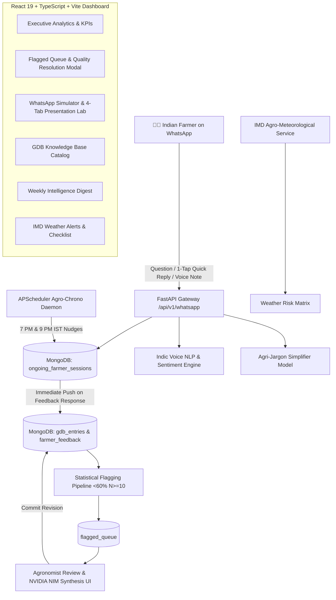

# 🌾 AjraSakha Agri-Intel | Farmer Feedback & Autonomous Quality Assurance System

> **Farmer Answer Feedback Loop & Quality Assurance Pipeline for AjraSakha (ANNAM.AI / IIT Ropar)**  
> *Closing the loop between rural Indian farmers and AI agricultural advisory systems.*

[](https://fastapi.tiangolo.com)
[](https://react.dev)
[](https://www.typescriptlang.org)
[](https://vitejs.dev)
[](https://www.mongodb.com)
[](https://www.python.org)
[](https://www.twilio.com)
[](LICENSE)

---

## 📖 Overview

**AjraSakha Agri-Intel** is a full-stack, automated quality feedback and knowledge-refinement platform built for Indian smallholder farmers interacting with the **AjraSakha** agricultural advisory bot.

It solves real-world agricultural hurdles:
- **Fieldwork vs. Feedback Void**: Solves daytime non-response with automated **Agro-Chrono Evening Leisure Nudges** at **7:00 PM** and **9:00 PM IST**.
- **Effortless Farmer Interaction**: Captures instant feedback using **1-Tap WhatsApp Quick-Reply buttons** (`👍 उपयोगी / 👎 सुधार चाहिए`) and **Multimodal Indic Voice Notes**.
- **Real-Time Knowledge Quality**: Evaluates live farmer feedback, pushes ratings immediately to knowledge base entries, and automatically routes deteriorating answers (`<60% helpful`, `N >= 10`) into an agronomist resolution queue.
- **Village-Level Normalization**: Integrates the **Agri-Jargon Simplifier** to convert complex metric chemical dosages into standard 15-liter spray tank (*"टंकी"*) proportions.
- **Micro-Climate Preparedness**: Delivers live **IMD Agro-Meteorological Weather Risk Advisories** with actionable crop checklists.

> 📄 For exhaustive technical architecture, data schemas, and lifecycle workflows, please see [PROJECT.md](file:///c:/Dev/FarmersFeedback/PROJECT.md).

---

## 🌾 System Architecture



---

## 🚀 Running the Project

### 1. Prerequisites
- **Python 3.12+** with `uv` installed (`pip install uv` or `curl -LsSf https://astral.sh/uv/install.sh`)
- **Node.js 18+** with `npm`
- **MongoDB** running locally on port `27017`

### 2. Environment Configuration
Copy the template configuration:
```bash
cp .env.example .env
```
*(The system works out-of-the-box with default settings. If Twilio or NVIDIA credentials are left blank, high-fidelity local simulation gateways are automatically engaged.)*

### 3. Backend Setup
From the repository root:
```bash
# 1. Install dependencies
uv sync

# 2. Seed database with knowledge base and 300+ sample feedback interactions
uv run python backend/seed_data.py

# 3. Start the FastAPI server (Runs on http://localhost:8000)
uv run python run_backend.py
```
- API Documentation (Swagger UI): **`http://localhost:8000/docs`**
- Health Check: **`http://localhost:8000/api/health`**

### 4. Frontend Setup
From the `frontend/` directory:
```bash
cd frontend

# Install npm dependencies
npm install

# Start the Vite development server
npm run dev
```
Open your browser at **`http://localhost:5173`**.

### 5. Running the Agri-Jargon Simplifier Standalone
To run the village-level Hindi NLP normalizer demo:
```bash
cd model
uv run python src/model/demo.py
```

---

## 🗺️ Route Endpoints (React Router v7)

| Endpoint | Component | Purpose |
| :--- | :--- | :--- |
| **`/`** or **`/analytics`** | [AnalyticsPage.tsx](file:///c:/Dev/FarmersFeedback/frontend/src/pages/AnalyticsPage.tsx) | Executive KPI counters, domain performance, root cause breakdown, and state-level satisfaction |
| **`/flagged`** | [FlaggedPage.tsx](file:///c:/Dev/FarmersFeedback/frontend/src/pages/FlaggedPage.tsx) | Statistical flagging queue (`<60%`), NVIDIA NIM LLM revision modal, and threshold controls |
| **`/whatsapp`** | [WhatsAppPage.tsx](file:///c:/Dev/FarmersFeedback/frontend/src/pages/WhatsAppPage.tsx) | 4-Tab Interactive Presentation Lab, WhatsApp mobile simulator, and live cron monitor |
| **`/gdb`** | [GdbPage.tsx](file:///c:/Dev/FarmersFeedback/frontend/src/pages/GdbPage.tsx) | Searchable Knowledge Base catalog with crop & domain filters |
| **`/digest`** | [DigestPage.tsx](file:///c:/Dev/FarmersFeedback/frontend/src/pages/DigestPage.tsx) | Weekly Agri Intelligence executive bulletin with export and print capabilities |
| **`/weather`** | [WeatherPage.tsx](file:///c:/Dev/FarmersFeedback/frontend/src/pages/WeatherPage.tsx) | Live IMD Agro-Meteorological warnings and actionable crop advisory checklist |
| **`*`** | [NotFoundPage.tsx](file:///c:/Dev/FarmersFeedback/frontend/src/pages/NotFoundPage.tsx) | 404 handler with intuitive redirection back to executive analytics |

---

## ✨ Key Features & Components

### 1. 📊 Executive Analytics & Root-Cause Engine
- **Live KPIs**: Overall Helpfulness %, Total Feedbacks Captured, Indic Voice Notes Processed, GDB Entries, and Pending Flags.
- **Domain Breakdown**: Helpfulness satisfaction across *Pest & Disease*, *Nutrient & Fertilizer*, *Irrigation Scheduling*, and *Weed Management*.
- **Root-Cause Drilldown**: Real-time telemetry on farmer dissatisfaction (*Unclear Dosage*, *Incorrect Chemical*, *Wrong Stage*, *High Cost*, *Weather Mismatch*, *Complex Language*).
- **Regional Telemetry**: Satisfaction distribution across Punjab, Haryana, Rajasthan, Uttar Pradesh, and Madhya Pradesh.

### 2. 🚨 Statistical Flagging & AI-Assisted Resolution
- **Wilson-Score Statistical Thresholds**: Automatically detects GDB entries dropping below `< 60% helpfulness` with `N >= 10` feedback responses.
- **Agronomist Resolution Modal**: Side-by-side comparison of original answers against farmer pain points.
- **NVIDIA NIM LLM Synthesis**: AI-assisted rewriting enforcing strict agronomic accuracy and a concise `< 100` word limit in both Hindi and English.
- **Real-Time Hot-Patching**: Immediately commits revised guidance to MongoDB `gdb_entries` and marks issues resolved.

### 3. 💬 Twilio WhatsApp Integration & 4-Tab Presentation Lab
- **Authentic WhatsApp Simulator**: Simulates two-turn interactions with 1-Tap Quick-Reply buttons (`👍 1: Helpful` / `👎 2: Unhelpful`) and voice note sentiment analysis.
- **Immediate GDB Push Lifecycle**: Completed feedback is immediately recorded in GDB metrics and purged from active sessions. Pure inquiries without rating are never counted as feedback.
- **Agro-Chrono Leisure Nudges**: Scheduled via APScheduler at **7:00 PM IST** and **9:00 PM IST** exclusively for unresponded farmers.
- **Interactive Presentation Lab**:
  - *Tab 1*: 4-Step Interactive Simulation Wizard (Inquiry $\rightarrow$ Nudge $\rightarrow$ Feedback $\rightarrow$ GDB Push).
  - *Tab 2*: Active Ongoing Sessions Monitor with per-session manual nudge & push controls.
  - *Tab 3*: Cron Automation Control Center with live diagnostic status and manual trigger button.
  - *Tab 4*: Gateway Webhook & Twilio Message Inspector.

### 4. 🧪 Agri-Jargon Simplifier (Village-Level Normalization)
- Custom NLP normalization engine located in `model/src/model/`.
- Converts complex metric rates (e.g. 250 ml/ha) into rural Indian farm units: **15-liter spray tanks (*"टंकी"* / Tanki)**.
- Replaces intimidating chemical formulations with certified local brand names and conversational Hindi instructions.

### 5. 🌦️ IMD Weather Risk Matrix & Weekly Digest
- **Agro-Meteorological Warnings**: Real-time frost, unseasonal rainfall, and heatwave alert monitoring.
- **Crop-Specific Checklist**: Generates pre-emptive spray and irrigation advisories linked to meteorological forecasts.
- **Weekly Executive Digest**: Synthesizes weekly KPIs, recurring defects, and action priorities into a printable bulletin.

---

## 👥 Contributors & Core Team

We recognize and credit the contributors who committed code and built this project:

| Contributor | Role & Key Contributions | Profile |
| :--- | :--- | :--- |
| **Captain D. Ezio** | **Project Lead & Full-Stack Architect**<br>• Project vision, architecture, and FastAPI backend engineering<br>• WhatsApp Twilio service, webhook pipeline & 4-Tab Simulation Lab<br>• Ongoing farmer sessions lifecycle & immediate GDB rating push<br>• APScheduler Agro-Chrono 7 PM & 9 PM IST background cron<br>• React 19 + TypeScript + Redux Toolkit dashboard & resolution workflows | [](https://github.com/iamgojoof6eyes)<br>📧 `iamgojoof6eyes@gmail.com` |
| **Divyanshi Mishra** | **ML & Backend Contributor**<br>• Agri-Jargon Simplifier NLP normalizer (`model/src/model`)<br>• Chemical registry, 15L tanki unit converter & rural evaluation dataset<br>• Backend modular restructuring & code organization<br>• Portable test suite configuration & seed dataset maintenance | [](https://github.com/divyanshimishra480)<br>📧 `divyanshimishra480@gmail.com` |

*Automated maintenance:*
- **Dependabot**: Automated dependency and vulnerability tracking.

---

## 🎖️ Credits & Acknowledgments

- **AjraSakha (ANNAM.AI / IIT Ropar)**: For providing the domain foundation, agricultural dataset context, and problem statement to empower Indian agriculture.
- **ICAR & Krishi Vigyan Kendras (KVK)**: For standard crop advisory protocols, package of practices, and agronomic thresholds.
- **India Meteorological Department (IMD)**: For agro-meteorological advisories, weather risk matrices, and frost/rainfall warning protocols.
- **Twilio**: For WhatsApp Business messaging infrastructure and interactive quick-reply button APIs.
- **NVIDIA NIM**: For high-performance Indic LLM inference and agronomic summarization pipelines.
- **FastAPI, React & MongoDB**: For the open-source frameworks powering the backend, frontend, and data tier.

---

## 📄 Documentation Links

- **[PROJECT.md](file:///c:/Dev/FarmersFeedback/PROJECT.md)**: Comprehensive architectural blueprint, sequence diagrams, and API specifications.
- **[to_do.md](file:///c:/Dev/FarmersFeedback/to_do.md)**: Implementation progress, feature checklists, and cron verification notes.
