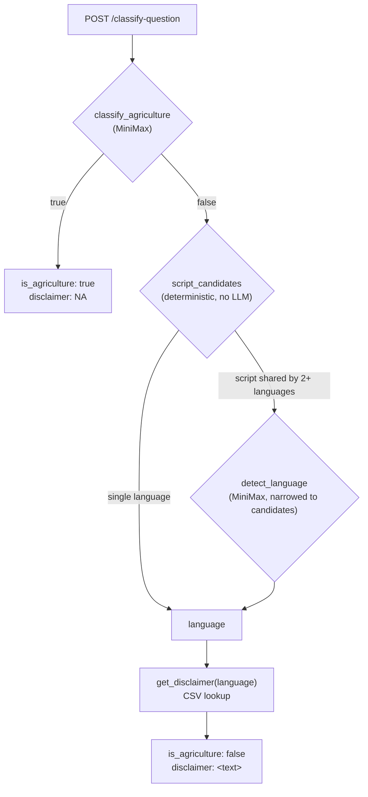

# Agriculture Question Classifier

Decides whether a farmer's question is agriculture-related, using MiniMax
LLM reasoning only - no Mongo lookup, no classification dataset. A
non-agriculture question gets a pre-written disclaimer back in its own
language, looked up from a CSV covering English + 22 Indian scheduled
languages - never translated or generated at runtime.

Port `8005`.

## How it works



1. `classify_agriculture` asks MiniMax whether the question is about crop
   cultivation, pest/disease management, fertilizers, irrigation, or other
   agriculture-related topics - tolerant of spelling mistakes and any
   language/script.
2. If it's agriculture-related, the response is immediate - no further
   calls.
3. If not, the question's dominant Unicode script is detected first
   (`disclaimers.script_candidates`, pure Python, no LLM). Most scripts map
   to exactly one language (Tamil, Telugu, Gujarati, Punjabi, ...) and
   return directly. A script shared by several languages - Devanagari
   (Hindi/Marathi/Nepali/Sanskrit/Maithili/Bodo/Konkani/Dogri),
   Perso-Arabic (Urdu/Kashmiri/Sindhi), Bengali-Assamese - asks MiniMax to
   pick among only that narrowed set, instead of freely from all 23 names.
4. The resolved language is looked up in the CSV. An unrecognized language
   falls back to the English row.

Both the known-language list and the script groupings are derived from the
CSV's own text at load time, not hardcoded - a new language row works
automatically as long as it uses an already-covered script.

## Endpoints

### `POST /classify-question`

Request:
```json
{ "question": "How often should I irrigate my wheat crop during flowering stage?" }
```

Response (agriculture-related):
```json
{ "is_agriculture": true, "disclaimer": "NA" }
```

Response (not agriculture-related):
```json
{ "is_agriculture": false, "disclaimer": "<pre-written text in the question's own language>" }
```

`400` if `question` is empty. `503` if MiniMax is unreachable or its
response can't be parsed.

### `GET /health`

```json
{ "status": "ok" }
```

## Setup

Copy `.env.example` to `.env` and fill in:

| Var | Default | Description |
|---|---|---|
| `MINIMAX_BASE_URL` | `https://api.minimax.io/v1` | Public MiniMax API by default. Set to the self-hosted tailnet host instead (see `.env.example`'s Option B) to use that model - no code change needed either way. |
| `MINIMAX_API_KEY` | — | |
| `MINIMAX_MODEL` | `MiniMax-M2.7` | `MiniMaxAI/MiniMax-M2.7` for the self-hosted host - different model ID string, not the bare default. |
| `MINIMAX_CHAT_PATH` | `/text/chatcompletion_v2` | `/chat/completions` for the self-hosted host. |
| `MINIMAX_TIMEOUT_SECONDS` | `90` | |
| `MINIMAX_SEED` | `0` | Reduces, doesn't eliminate, run-to-run model variance. |
| `TAILSCALE_AUTHKEY` | — | Only needed when `MINIMAX_BASE_URL` is the self-hosted tailnet host. Leave unset to use the public API - the container boots fine without it (fails open). |
| `TAILSCALE_HOSTNAME` | `agriculture-classifier` | |

## Deployment

The container respects `$PORT` (defaults to `8005` if unset) - required for
Cloud Run, which injects its own `$PORT` and expects the container to
listen on it. Verified locally with `docker run -e PORT=8080` and with no
`PORT` set.

Tailscale is optional, set up the same way as
`apis/writing_assistant/scripts/start.sh`: if `TAILSCALE_AUTHKEY` is set,
`scripts/start.sh` joins the tailnet before starting the server, so
`MINIMAX_BASE_URL` can point at the self-hosted model; if it's unset, or
`tailscale up` fails or can't reach the control plane, it logs that and
starts the server anyway (never blocks boot indefinitely). A machine
already joined to the tailnet directly (no containerized Tailscale hop
running, e.g. a dev laptop) connects straight through instead -
`llm_client._is_socks_proxy_active()` checks live rather than assuming a
local SOCKS proxy is always there.

Currently deployed on Render for testing:
**[Swagger UI](https://ajrasakha-agriculture-classifier.onrender.com/docs)**

## Known behavior and limitations

- **The self-hosted MiniMax-M2.7 model has two confirmed, unresolved
  issues**, found by live-testing language detection against it (not
  present when using the public API, which passes all 23 languages):
  - **Dogri reliably times out** - every attempt so far (multiple separate
    tests) hangs past the configured `MINIMAX_TIMEOUT_SECONDS` budget
    rather than returning an answer. Looks like a runaway generation loop
    on that specific input, not a "model doesn't know Dogri" problem - a
    `max_tokens` cap on requests (not currently set) may bound this, but
    this hasn't been fixed yet.
  - **Bodo and Konkani are intermittently misidentified** (observed as
    each other and as Hindi/Marathi/Punjabi across different test runs) -
    consistent with this model's general run-to-run inconsistency at
    temperature 0 (see `MINIMAX_SEED` above), not a fixed bias toward one
    wrong answer.
  - Both are issues with the self-hosted model/serving stack itself, not
    this service's code - there is no fix available here that doesn't
    mean hardcoding a per-language override, which this service
    deliberately avoids (see "How it works" above).
  - Every other language, on both the public and self-hosted model, has
    been correct in every test run so far.

## Testing

```
pytest apis/agriculture_classifier/tests/
```

22 tests, all MiniMax calls mocked - no real network calls.
