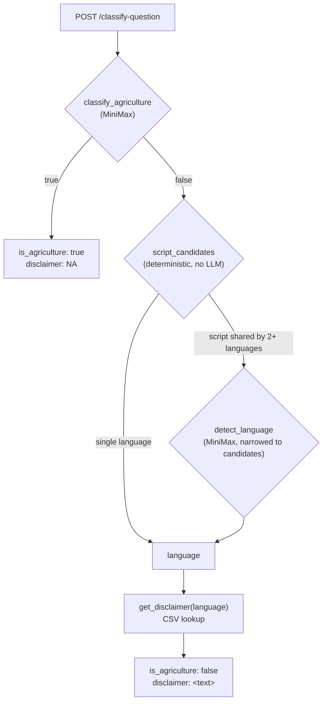

# Agriculture Question Classifier

Decides whether a farmer's question is agriculture-related, using MiniMax
LLM reasoning only - no Mongo lookup, no classification dataset. A
non-agriculture question gets a pre-written disclaimer back in its own
language, looked up from a CSV covering English + 22 Indian scheduled
languages - never translated or generated at runtime.

Port `8005`.

## How it works



1. `classify_agriculture` asks MiniMax whether the question is about crop
   cultivation, pest/disease management, fertilizers, irrigation, or other
   agriculture-related topics - tolerant of spelling mistakes and any
   language/script.
2. If it's agriculture-related, the response is immediate - no further
   calls.
3. If not, the question's dominant Unicode script is detected first
   (`disclaimers.script_candidates`, pure Python, no LLM). Most scripts map
   to exactly one language (Tamil, Telugu, Gujarati, Punjabi, ...) and
   return directly. A script shared by several languages - Devanagari
   (Hindi/Marathi/Nepali/Sanskrit/Maithili/Bodo/Konkani/Dogri),
   Perso-Arabic (Urdu/Kashmiri/Sindhi), Bengali-Assamese - asks MiniMax to
   pick among only that narrowed set, instead of freely from all 23 names.
4. The resolved language is looked up in the CSV. An unrecognized language
   falls back to the English row.

Both the known-language list and the script groupings are derived from the
CSV's own text at load time, not hardcoded - a new language row works
automatically as long as it uses an already-covered script.

## Endpoints

### `POST /classify-question`

Request:
```json
{ "question": "How often should I irrigate my wheat crop during flowering stage?" }
```

Response (agriculture-related):
```json
{ "is_agriculture": true, "disclaimer": "NA" }
```

Response (not agriculture-related):
```json
{ "is_agriculture": false, "disclaimer": "<pre-written text in the question's own language>" }
```

`400` if `question` is empty. `503` if MiniMax is unreachable or its
response can't be parsed.

### `GET /health`

```json
{ "status": "ok" }
```

## Setup

Copy `.env.example` to `.env` and fill in:

| Var | Default | Description |
|---|---|---|
| `MINIMAX_BASE_URL` | `https://api.minimax.io/v1` | Public MiniMax API - no self-hosted/Tailscale hop needed for this service. |
| `MINIMAX_API_KEY` | — | |
| `MINIMAX_MODEL` | `MiniMax-M2.7` | |
| `MINIMAX_CHAT_PATH` | `/text/chatcompletion_v2` | |
| `MINIMAX_TIMEOUT_SECONDS` | `90` | |
| `MINIMAX_SEED` | `0` | Reduces, doesn't eliminate, run-to-run model variance. |

## Deployment

The container respects `$PORT` (defaults to `8005` if unset) - required for
Cloud Run, which injects its own `$PORT` and expects the container to
listen on it. Verified locally with `docker run -e PORT=8080` and with no
`PORT` set.

Currently deployed on Render for testing:
**[Swagger UI](https://ajrasakha-agriculture-classifier.onrender.com/docs)**

## Testing

```
pytest apis/agriculture_classifier/tests/
```

16 tests, all MiniMax calls mocked - no real network calls.
