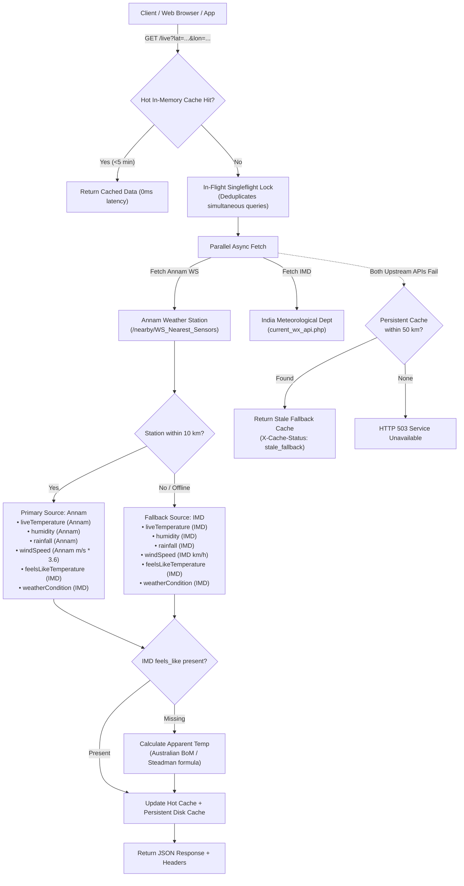

# Ajrasakha Live Weather API

A high-performance, production-ready REST microservice built with **FastAPI** to deliver real-time, hyper-local meteorological data for agricultural and consumer applications.

---

## 📑 Table of Contents

- [Architecture & Data Priority](#-architecture--data-priority)
- [Multi-Tier Caching & High Availability](#-multi-tier-caching--high-availability)
- [Website Visitor & Traffic Reduction Solutions](#-website-visitor--traffic-reduction-solutions)
- [API Endpoints & Schema](#-api-endpoints--schema)
  - [1. GET /live](#1-get-live-or-get-weatherlive)
  - [2. GET /live/details](#2-get-livedetails)
  - [3. GET /health](#3-get-health)
  - [4. POST /cache/clear](#4-post-cacheclear)
- [Diagnostic HTTP Headers](#-diagnostic-http-headers)
- [Error Handling & Status Codes](#-error-handling--status-codes)
- [Interactive Testing & cURL Examples](#-interactive-testing--curl-examples)
- [Environment Configuration](#-environment-configuration)
- [Local Development & Testing](#-local-development--testing)
- [Project Structure](#-project-structure)

---

## 🏗 Architecture & Data Priority

The service implements a hybrid meteorological data model designed to maximize spatial precision, reliability, and human-comfort metrics:



### Source Prioritization Rules

| Metric | Source Priority 1: Annam Weather Station (<= 10 km) | Source Priority 2: IMD (Fallback / Out of range) |
|---|---|---|
| **`liveTemperature`** | Annam sensor observation (`Temperature` in °C) | IMD city station observation (`temperature_c` in °C) |
| **`humidity`** | Annam sensor observation (`Humidity` %) | IMD city station observation (`humidity_pct` %) |
| **`rainfall`** | Annam sensor counter (`Rainfall` in mm) | IMD 24h rainfall (`past_24hrs_rainfall_mm` in mm) |
| **`windSpeed`** | Annam sensor (`WindSpeed` m/s converted to km/h via `* 3.6`) | IMD station (`wind_speed_kmph` in km/h) |
| **`feelsLikeTemperature`** | **IMD API** (`Feel Like` / `feel_like_c`) *(see calculation fallback below)* | **IMD API** (`Feel Like` / `feel_like_c`) |
| **`weatherCondition`** | **IMD API** (`WEATHER_MESSAGE` / `weather_condition`, e.g. "Partly Cloudy") | **IMD API** (`WEATHER_MESSAGE` / `weather_condition`) |

#### Apparent Temperature Fallback:
If an IMD station leaves `feel_like_c` blank, the service dynamically computes apparent temperature using the standard **Australian Bureau of Meteorology (Steadman)** formula:
$$AT = T_a + 0.33 \times e - 0.70 \times w - 4.00$$
where $T_a$ is dry bulb temperature (°C), $e$ is water vapor pressure (hPa) derived from relative humidity, and $w$ is wind speed (m/s).

---

## ⚡ Multi-Tier Caching & High Availability

To guarantee sub-millisecond responses and 99.99% uptime during external API outages, a two-layer cache is implemented:

### 1. Hot In-Memory Cache (TTL: 5 Minutes)
- **Coordinate Grid Snapping**: Requests are grouped into `(round(lat, 2), round(lon, 2))` grid cells (~1.1 km resolution).
- Subsequent queries for the same neighborhood are served directly from RAM in **0.001s** with `X-Cache-Status: hot_ttl`.

### 2. Persistent Fallback Cache (Last Known Good)
- Stored permanently on disk at `cache/weather_cache.json`.
- **Zero-Downtime Guarantee**: If upstream weather APIs experience downtime, timeouts, or network loss, the service locates the nearest cached observation within **50 km** and returns it with `X-Cache-Status: stale_fallback` instead of returning a 500/503 error.

---

## 🌐 Website Visitor & Traffic Reduction Solutions

### Problem
When visitors open the website, navigate between pages, or refresh the screen, repeated API requests can cause unnecessary server load, rate limiting, and slow page loads.

### Solutions Implemented & Recommended

#### 1. Browser & CDN Caching (Active in API)
Every response contains HTTP caching headers:
```http
Cache-Control: public, max-age=300, stale-while-revalidate=60
ETag: "9f82d1c81..."
```
- **Browser Memory Cache**: The user's browser caches the weather for 5 minutes. Refreshing the page or navigating site links makes **zero network requests** to your backend.
- **Conditional GET (`304 Not Modified`)**: When 5 minutes expire, the browser checks back with `If-None-Match`. If weather has not changed, the server returns `304 Not Modified` with zero data payload.
- **CDN Edge Nodes**: If using Cloudflare or CloudFront, requests for the same city are served directly from edge locations.

#### 2. In-Flight Request Deduplication (Singleflight Pattern)
If 50 users from the same city visit your website at the exact same millisecond before the cache is warm, the backend uses an asynchronous lock (`asyncio.Lock` per grid cell). Only **1 request** makes the external network call; the other 49 wait and immediately share the result from memory.

#### 3. Client-Side Frontend Implementation

##### Vanilla JavaScript / TypeScript:
```javascript
async function getLiveWeather(lat, lon) {
  // Snap coordinates to 2 decimal places to absorb GPS drift (~1.1km)
  const gridLat = Number(lat.toFixed(2));
  const gridLon = Number(lon.toFixed(2));
  const cacheKey = `weather_${gridLat}_${gridLon}`;

  // Check localStorage (10-minute validity)
  const cached = localStorage.getItem(cacheKey);
  if (cached) {
    try {
      const { data, timestamp } = JSON.parse(cached);
      if ((Date.now() - timestamp) / 60000 < 10) {
        return data; // Instant 0ms return!
      }
    } catch (e) {
      localStorage.removeItem(cacheKey);
    }
  }

  // Fetch from API
  const response = await fetch(`/live?lat=${gridLat}&lon=${gridLon}`);
  if (!response.ok) throw new Error("Weather API request failed");
  const data = await response.json();

  localStorage.setItem(cacheKey, JSON.stringify({ data, timestamp: Date.now() }));
  return data;
}
```

##### React / TanStack Query:
```jsx
import { useQuery } from "@tanstack/react-query";

export function useLiveWeather(lat, lon) {
  const gridLat = lat ? Number(lat.toFixed(2)) : null;
  const gridLon = lon ? Number(lon.toFixed(2)) : null;

  return useQuery({
    queryKey: ["live-weather", gridLat, gridLon],
    queryFn: () => fetch(`/live?lat=${gridLat}&lon=${gridLon}`).then(r => r.json()),
    enabled: !!(gridLat && gridLon),
    staleTime: 5 * 60 * 1000,    // 5 minutes
    gcTime: 30 * 60 * 1000,       // 30 minutes
    refetchOnWindowFocus: false,  // Do not refetch on tab switch
  });
}
```

---

## 📡 API Endpoints & Schema

### 1. `GET /live` (or `GET /weather/live`)

Main production endpoint returning the exact required weather observation format.

#### Query Parameters:
| Parameter | Type | Required | Description | Range |
|---|---|---|---|---|
| `lat` | `float` | Yes | Latitude in decimal degrees | `-90.0` to `90.0` |
| `lon` | `float` | Yes* | Longitude in decimal degrees | `-180.0` to `180.0` |
| `long` | `float` | Yes* | Longitude alias (can pass `lon` or `long`) | `-180.0` to `180.0` |

*\*Provide either `lon` or `long`.*

#### Response (`200 OK`):
```json
{
  "liveTemperature": 32.5,
  "humidity": 65.0,
  "rainfall": 0.0,
  "windSpeed": 12.4,
  "weatherCondition": "Partly Cloudy",
  "feelsLikeTemperature": 35.2
}
```

---

### 2. `GET /live/details`

Returns the exact same live observation plus diagnostic metadata.

#### Response (`200 OK`):
```json
{
  "liveTemperature": 30.4,
  "humidity": 56.1,
  "rainfall": 0.0,
  "windSpeed": 2.9,
  "weatherCondition": "Haze",
  "feelsLikeTemperature": 31.8,
  "source": "annam+imd",
  "stationName": "Bandlaguda (Annam AWS: #20)",
  "stationDistanceKm": 4.4,
  "isCached": true,
  "cacheType": "hot_ttl",
  "recordedAt": "2026-11-04T06:08:50.183826+00:00",
  "cacheAgeSeconds": 6.4
}
```

---

### 3. `GET /health`

System health, cache statistics, and upstream connectivity status.

#### Response (`200 OK`):
```json
{
  "status": "healthy",
  "service": "ajrasakha-live-weather-api",
  "timestamp": "2026-11-04T06:08:29.428779+00:00",
  "cache": {
    "ttl_seconds": 300.0,
    "hot_cache_entries": 2,
    "persistent_cache_entries": 3,
    "stats": {
      "hot_hits": 4,
      "hot_misses": 2,
      "fallback_hits": 0,
      "writes": 2
    }
  },
  "upstream": {
    "annam_ws_base": "https://5mqwg03znl.execute-api.us-east-1.amazonaws.com",
    "annam_max_distance_km": 10.0,
    "imd_city_base": "http://100.100.108.101:18080/city/api"
  }
}
```

---

### 4. `POST /cache/clear`

Operational maintenance endpoint to clear the in-memory hot cache.

---

## 🏷 Diagnostic HTTP Headers

Every response carries diagnostic and cache headers:

| Header | Example Value | Description |
|---|---|---|
| `X-Weather-Source` | `annam+imd` / `imd` / `stale_fallback` | Upstream data provider used |
| `X-Cache-Status` | `hot_ttl` / `stale_fallback` / `MISS` / `NOT_MODIFIED` | Cache resolution status |
| `X-Station-Name` | `Bandlaguda (Annam AWS: #20)` | Closest reporting station |
| `X-Station-Distance-KM`| `4.4` | Great-circle distance to station |
| `X-Process-Time` | `0.002s` | Server processing latency |
| `Cache-Control` | `public, max-age=300, stale-while-revalidate=60` | Browser/CDN caching directive |
| `ETag` | `"1b0922883a45c364c6df7318ecf518e1"` | Content hash for 304 revalidation |

---

## 🛡 Error Handling & Status Codes

| HTTP Status | Reason | JSON Response Format |
|---|---|---|
| `400 Bad Request` | Missing longitude parameter | `{"status": "error", "message": "Longitude parameter is required. Provide either 'lon' or 'long'."}` |
| `422 Unprocessable` | Latitude/Longitude outside geographical limits | `{"status": "error", "message": "Invalid query parameters", "detail": [...]}` |
| `503 Service Unavailable` | Upstream APIs down AND no fallback cache | `{"status": "error", "message": "Live weather services are currently unreachable and no cached observation is available..."}` |
| `500 Internal Error` | Unexpected runtime error | `{"status": "error", "message": "An internal server error occurred..."}` |

---

## 🧪 Interactive Testing & cURL Examples

### 1. Interactive Swagger UI
Open your browser to:
- [http://localhost:8085/docs](http://localhost:8085/docs)
- [http://localhost:8085/redoc](http://localhost:8085/redoc)

### 2. cURL Commands

#### Hyderabad (Annam Sensor Priority + IMD Feels-Like):
```bash
curl -s "http://localhost:8085/live?lat=17.3850&lon=78.4867"
```

#### Delhi (IMD Fallback):
```bash
curl -s "http://localhost:8085/live?lat=28.6139&lon=77.2090"
```

#### Detailed Metadata:
```bash
curl -s "http://localhost:8085/live/details?lat=17.3850&lon=78.4867"
```

#### Inspect Response Headers:
```bash
curl -i "http://localhost:8085/live?lat=17.3850&lon=78.4867"
```

#### Test Conditional GET (304 Not Modified):
```bash
curl -i -H 'If-None-Match: "1b0922883a45c364c6df7318ecf518e1"' "http://localhost:8085/live?lat=17.3850&lon=78.4867"
```

#### Health Check:
```bash
curl -s "http://localhost:8085/health"
```

---

## ⚙️ Environment Configuration

You can override defaults via `.env` or system environment variables:

| Variable | Default Value | Description |
|---|---|---|
| `PORT` | `8085` | Server listening port |
| `HOST` | `0.0.0.0` | Server binding host |
| `WS_NEAREST_SENSORS_BASE_URL` | `https://5mqwg03znl.execute-api.us-east-1.amazonaws.com` | Annam Weather Station base URL |
| `WS_MAX_DISTANCE_KM` | `10.0` | Maximum distance (km) to accept Annam station |
| `WS_TIMEOUT_SECONDS` | `6.0` | Annam API HTTP timeout |
| `IMD_CITY_BASE` | `http://100.100.108.101:18080/city/api` | IMD Mirror API base URL |
| `IMD_TIMEOUT_SECONDS` | `6.0` | IMD API HTTP timeout |
| `WEATHER_CACHE_TTL_SECONDS` | `300.0` | Hot cache expiration (5 minutes) |
| `FALLBACK_MAX_DISTANCE_KM` | `50.0` | Maximum search radius for persistent cache during outages |
| `WEATHER_CACHE_DIR` | `./cache` | Directory for persistent cache storage |

---

## 💻 Local Development & Testing

### 1. Install Dependencies
```bash
pip install -r requirements.txt
```
*(Or with `uv`)*:
```bash
uv pip install -r requirements.txt
```

### 2. Start the Server
```bash
python main.py
```
*(Or with `uvicorn` directly)*:
```bash
uvicorn main:app --host 0.0.0.0 --port 8085 --reload
```

### 3. Run Automated Tests
A test suite covering distance calculations, apparent temperature, Annam priority, IMD fallback, hot cache hits, 304 conditional revalidation, and simulated outages is included:

```bash
pytest test_api.py -v
```

---

## ☁️ Free Hosting on Render

Render offers a 100% free tier for web services with automated SSL and GitHub deployment.

### Quick Deploy via Web Dashboard:
1. Log in to **[dashboard.render.com](https://dashboard.render.com/)**.
2. Click **New +** > **Web Service**.
3. Select your GitHub repository.
4. Fill in the following fields:
   - **Name**: `ajrasakha-live-weather`
   - **Root Directory**: `apis/weather_apis` *(Crucial for monorepos!)*
   - **Runtime**: `Python 3`
   - **Build Command**: `pip install -r requirements.txt`
   - **Start Command**: `uvicorn main:app --host 0.0.0.0 --port $PORT`
   - **Instance Type**: Select **Free**
5. Under **Advanced** > **Health Check Path**, enter: `/health`.
6. Click **Create Web Service**.

Your live API will be instantly deployed at `https://ajrasakha-live-weather.onrender.com/live?lat=17.3850&lon=78.4867`.

---

## 📂 Project Structure

```
apis/weather_apis/
├── main.py               # Complete FastAPI application & business logic
├── requirements.txt      # Production dependencies
├── Dockerfile            # Container configuration with Tailscale support
├── docker-compose.yml    # Docker compose specification
├── render.yaml           # Render blueprint for one-click deployment
├── scripts/
│   └── start.sh          # Container boot script with port & Tailscale handling
├── test_api.py           # Pytest test suite (11 unit & integration tests)
├── .env.example          # Environment variables template
├── README.md             # Complete documentation
└── cache/
    └── weather_cache.json # Persistent last-known-good offline fallback store
```
